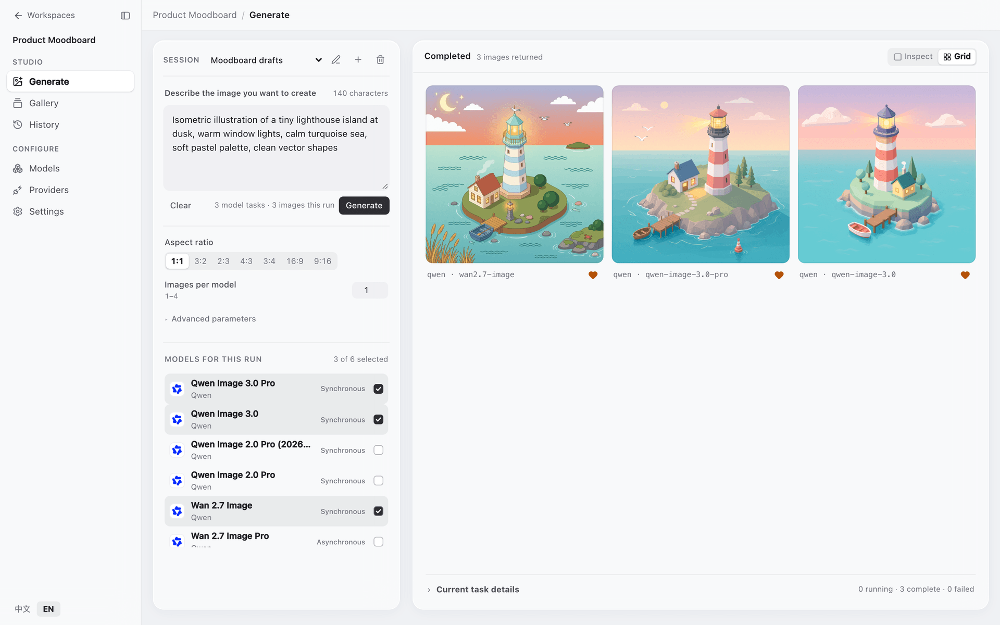
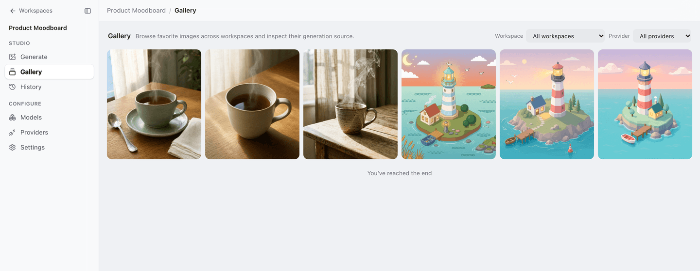
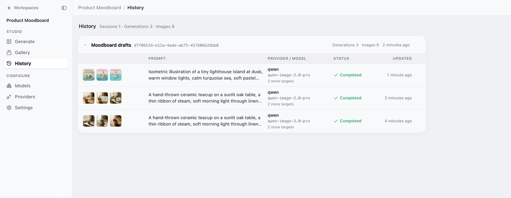
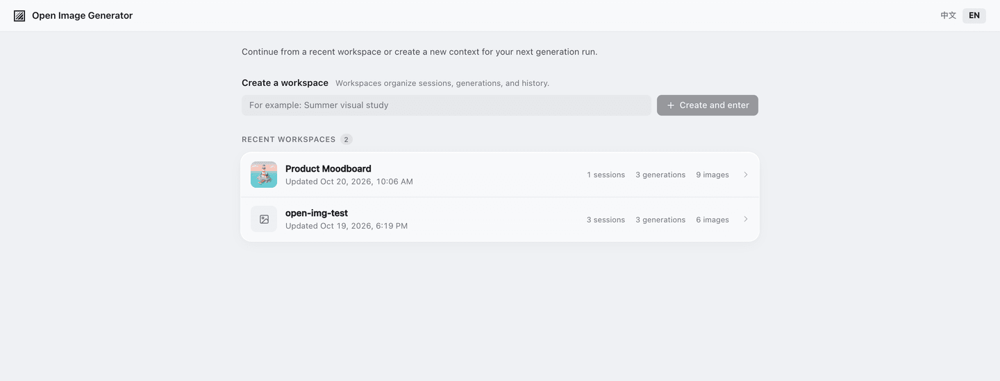
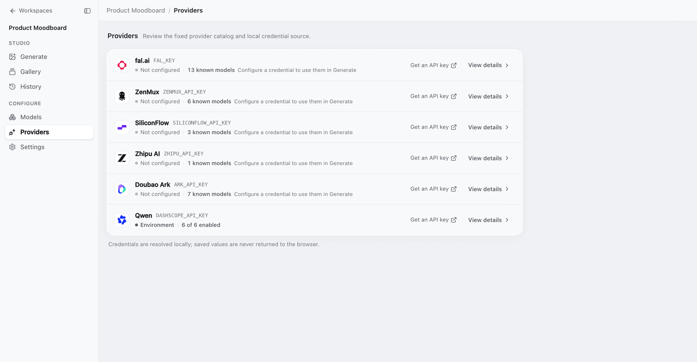
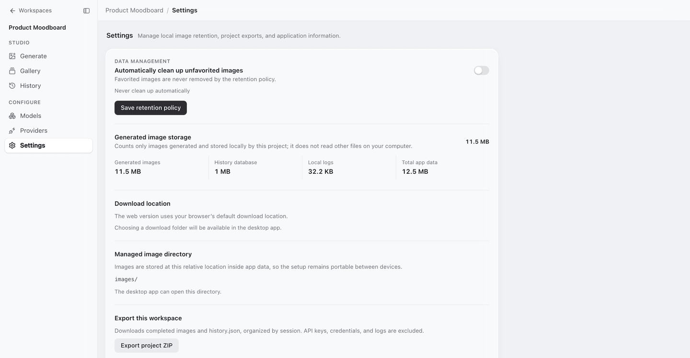

<div align="center">


### 所有生图模型，一个本地工作台

写一条提示词，同时交给多个生图模型，生成的图片都保存在你自己的电脑上。<br>
支持通义 Qwen、豆包、智谱、SiliconFlow、fal.ai 和 ZenMux。

[](LICENSE)    

**[快速开始](#快速开始)** &nbsp;·&nbsp; **[支持的服务商](#支持的服务商)** &nbsp;·&nbsp; **[功能](#功能)** &nbsp;·&nbsp; **[桌面版](#macos-桌面版)** &nbsp;·&nbsp; [English](README.md) · **简体中文**

<br>



</div>

<br>

## 为什么用它

每家生图服务都有自己的控制台和参数，想比较几个模型，通常得来回切换网页、手动下载图片。open-img generator 把它们放进一个本地应用里：

- 一条提示词可以在一次运行中交给多个模型，结果并排返回。
- 表单会按所选模型的能力调整：生成张数、宽高比、seed 和负面提示词都以模型实际支持的为准。
- 图片、历史记录和设置都保存在本机。API Key 只留在服务端，不会发到浏览器。

可以在浏览器里使用（Next.js），也有 macOS 桌面版（Electron）。

## 快速开始

**1 · 使用 Node.js 24。** 支持 Node 20、22、24 的 LTS 版本，`.nvmrc` 固定为 24。不要用 Current 版本：SQLite 原生模块只在 LTS 上测试过。

```sh
nvm install && nvm use
```

<sub>macOS 上也可以用 Homebrew 和 direnv 代替 nvm：运行 `brew install node@24 direnv`，看一遍 `.envrc` 的内容，再运行 `direnv allow .`。它只会在本目录内把 Homebrew 的 `node@24/bin` 放到 `PATH` 最前面。</sub>

**2 · 配置服务商的 API Key。** 复制示例配置文件，至少填写[下表](#支持的服务商)中的一个 Key。

```sh
cp .env.example .env.local
```

**3 · 安装并启动。**

```sh
npm ci
npm run dev
```

打开 [http://localhost:3000](http://localhost:3000)，新建一个工作区。`npm run dev` 会先迁移数据库，再启动服务。

<sub>如果之前在其他 Node 主版本下安装过依赖，请切换到 Node 24 后重新运行 `npm ci`，让 SQLite 重新编译。如果只报了 `better-sqlite3` 的 `NODE_MODULE_VERSION` 不匹配，运行 `npm rebuild better-sqlite3` 即可，数据库不受影响。</sub>

## 支持的服务商

填了 Key 的服务商会自动启用，没填的直接跳过，不会报错。修改 `.env.local` 后需要重启开发服务。

| 服务商 | `.env.local` 中的 Key |
| --- | --- |
| fal.ai | `FAL_KEY` |
| ZenMux | `ZENMUX_API_KEY` |
| SiliconFlow | `SILICONFLOW_API_KEY` |
| 智谱 AI | `ZHIPU_API_KEY` |
| 豆包（火山引擎 Ark） | `ARK_API_KEY` |
| 通义 Qwen（阿里云百炼 DashScope） | `DASHSCOPE_API_KEY` |

区域网关、本地访问令牌（`APP_AUTH_TOKEN`）、图片保留期限、存储路径等可选配置，在 [`.env.example`](.env.example) 的注释里有说明。

## 功能

### 一次运行，比较多个模型

选好宽高比、每个模型生成几张，再勾选要用的模型，点击「开始生成」。同步返回的模型和排队异步返回的模型可以放在同一批里运行。任务面板会显示哪些任务正在运行、已完成或失败；结果网格里的每张图都标着来自哪个服务商和模型。

### 图库和历史

点击图片上的爱心即可收藏。**图库**汇总所有工作区的收藏，可以按工作区或服务商筛选。**历史**按会话列出每次生成的提示词、模型、状态和缩略图。

<table>
<tr>
<td width="50%"></td>
<td width="50%"></td>
</tr>
</table>

### 工作区和会话

工作区用来归类相关的工作，每个工作区下面有若干个会话（Session），会话里保存一连串的提示词和生成结果。首页列出最近的工作区，以及各自的会话数、生成次数和图片数。



### 服务商与本地数据

**服务商**页面显示每家服务商是否已配置、凭据从哪里读取，以及启用了几个模型。

应用数据默认保存在 `./data/` 下，包括 SQLite 数据库、生成的图片、设置和日志。**设置**页面可以查看这些数据占用的空间；可以开启自动清理，在指定天数后删除未收藏的图片（收藏的图片不会被删除）；还可以把一个工作区导出为 ZIP，里面是图片和 `history.json`，不包含 Key 和日志。

<table>
<tr>
<td width="50%"></td>
<td width="50%"></td>
</tr>
</table>

界面支持英文和简体中文。

## 生产运行

```sh
npm run build
npm start
```

`npm start` 会先以 production 模式迁移数据库。

## macOS 桌面版

```sh
npm run desktop:dev                  # 以开发模式运行 Electron 应用
npm run desktop:package:mac:arm64    # 打包 Apple Silicon 版 DMG
npm run desktop:package:mac:x64      # 打包 Intel 版 DMG
```

签名和公证见 [macOS 分发指南](docs/mvp/desktop-shell/macos-distribution.md)。

## 开发

```sh
npm run typecheck
npm test
npm run build
```

## 许可证

[Apache License 2.0](LICENSE)。第三方服务商的服务条款、商标以及生成内容的相关权利，不在本许可证的授予范围内。
